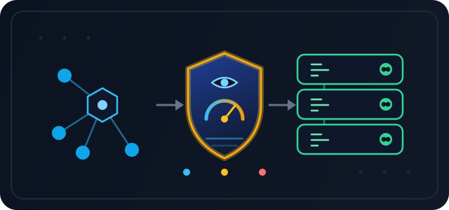
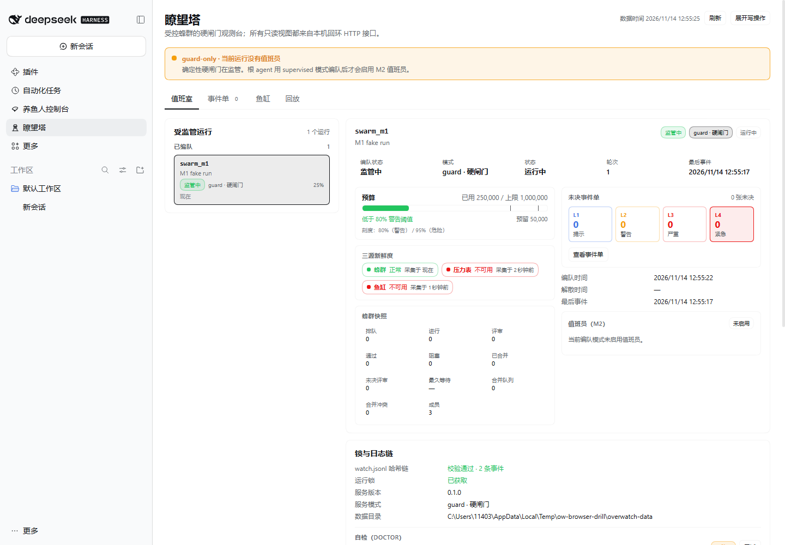
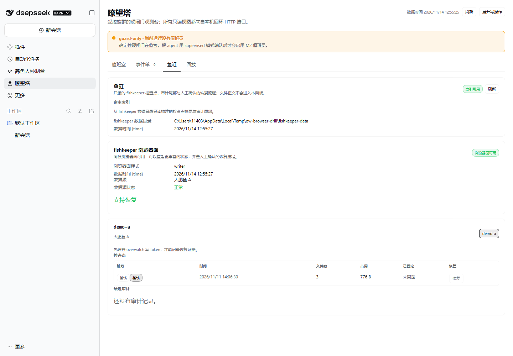

# dsh-overwatch

[](https://github.com/AiLunSin/dsh-overwatch/actions/workflows/ci.yml)
[](https://www.npmjs.com/package/@ailunsin/dsh-overwatch)
[](./LICENSE)
[](./package.json)
[](./docs/compatibility.md)
[](./README.en.md#verify)

[简体中文](./README.md) | English

> Supervised swarms for DeepSeek Harness: a **model-free hard guard** plus a **tool-restricted watch officer**, backed by an independent, hash-chained evidence log.
>
> Memory hook: **the model may judge but never act; hard limits never depend on a model; no evidence, no action.**

**Status: M0–M4 release candidate (watch officer experimental).** The bundle ships a Host
half and a Web panel, with real-DeepSeek-Harness 0.2.2-rc.3 probes for capability
(M0), guard-only supervision (M1), the watch officer (M2), fish tank / replay / doctor
/ restore evidence (M3), eight-scenario hardening plus release tooling (M4), and one
real DeepSeek account watch wake (9,958 tokens, accepted `coach` decision), a full
A/B/C comparison (27/27 PASS, 135,346 watch tokens, ¥2.1655), and real dsh-swarm
I-5/I-6/I-7 signal runs (3/3 PASS). `@ailunsin/dsh-overwatch@1.0.0` is published;
the M4.1 `1.0.1` release waits for the account holder's OTP.



## What it does

| Layer | Responsibility |
| --- | --- |
| **Guard** | Deterministic, model-free: throttle at 80% budget, hard pause at 95%, abort at 100%, abort on a swarm event gap. |
| **Watch** | One lazy, tool-restricted child agent (`watch_case`, `watch_evidence`, `watch_decide`) for L2+ cases; it proposes, the executor validates/authorizes/acts/verifies. |
| **Evidence** | Per-run `watch.jsonl` with a SHA-256 chain, materialized cases, shift handover, restore intent/result records. |

The watch officer never sees `bash`, `write`, `subagent`, `swarm_*` or merge
tools. Restrictions are applied synchronously in the serial `agent/created`
listener and re-applied on cold resume.

## Install

`@ailunsin/dsh-overwatch@1.0.0` is on npm. DSH 0.2.2-rc.3 has no public plugin
index, so package installs need a profile that can reach the registry:

```powershell
dsh plugin --profile ow add @ailunsin/dsh-overwatch@1.0.0
```

For development, install from a local directory:

```powershell
$env:DSH_HOME = "$env:TEMP\dsh-overwatch-try"
dsh --profile ow --from-default-profile web --dump-config
dsh plugin --profile ow add C:\path\to\dsh-overwatch
```

The panel appears in the sidebar as “Overwatch”. `GET /overwatch/api/health`
reports version, mode, chain state and source freshness.





## Use

```js
// root agent
watch_arm({ runId: 'swarm_xxx', mode: 'supervised' })
watch_status({ runId: 'swarm_xxx' })
watch_report({ runId: 'swarm_xxx' })
watch_disarm({ runId: 'swarm_xxx', reason: 'done' })
```

`supervised` requires the root agent, a write token, and
`non-queen members + 1 <= maxActiveSubagents`. HTTP can arm only
`guard`/`observe` because it has no agent tree.

Key configuration (`examples/profile-patch.yml` has a full example):

```yaml
- id: dsh-overwatch
  config:
    mode: guard
    http: { token: change-me }
    ports: { swarmToken: change-me, origin: '' }
    fish: { dataDir: '' }          # default ~/.dsh/fishkeeper
    policy:
      autopilot: { pauseOnHardLimit: true, abortOnHardLimit: true }
```

## Verify

```powershell
npm test        # 164 tests incl. the eight incident scenarios
npm run lint
npm run m0      # capability probe
npm run m1      # M1/M3 web end-to-end (33 checks)
npm run m2      # M2 watch officer headless end-to-end (12 checks)
npm run m4:real # one real-model watch wake (account credentials, 80k cap)
npm run m4:abc  # full A/B/C: real watch officer, scripted swarm members (¥10 cap)
npm run m4:swarm # real dsh-swarm I-5/I-6/I-7 (no model cost)
npm run build:release
npm run smoke:install
```

See [docs/m4.md](./docs/m4.md) for the hardening matrix, the A/B/C and real-swarm
results, and the remaining external gate (npm 1.0.1 OTP + tag/push).

## Boundaries

- A/B/C measures a real watch officer over a scripted swarm (no model-cost
  members); it is not a real-model worker productivity benchmark.
- Real dsh-swarm I-5/I-6/I-7 exercises the real market/review/gate/merge
  machinery with scripted worker edits, not model workers.
- `coach`/`throttle` text is recorded as a swarm `steer` event; upstream does not
  guarantee delivery to a member inbox.
- `pause` needs a human resume; `throttle` resumes only when overwatch paused.
- Fish data checkpoints/restores run in the browser; the Host is read-only and
  never stores fishkeeper confirm tokens.
- Total spend can reach `B + S` (S ≤ 5% of B) if overwatch crashes.
- The panel's real-browser restore/keyboard/AX drill is recorded in
  `e2e/m4/browser/results/`; CI still runs only the offline tests.

## License

MIT

Contributions: see [CONTRIBUTING.md](./CONTRIBUTING.md). For security issues,
use a private advisory as described in [SECURITY.md](./SECURITY.md).
